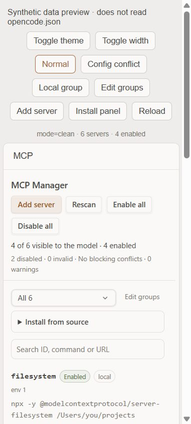

# openchamber-mcps

**MCP Manager** creates, edits, enables, disables, imports and removes OpenCode MCP servers by
editing the `mcp.servers` block of `~/.config/opencode/opencode.json`. It never touches the rest of
your config, never runs an MCP process, and never deletes a definition without saying where the
backup is.

It is a port of [openchamber-skills](https://github.com/chenyuhao0628/openchamber-skills) to a
different domain: MCP servers instead of skill files.

Current version **0.1.0**.

## Highlights

- Toggle a server with `"disabled": true` / `false` inside `mcp.servers` — the equivalent of the
  skills rename toggle.
- Add and edit servers from the panel: `type`, `command`, `cwd`, `environment`, `url`,
  `headers`, `enabled`, with inline validation before anything is written. `timeout`,
  `codemode`, `protocol` and `oauth` are preserved untouched.
- Reads the current `mcp.servers` schema and still lists deprecated top-level `mcp.<id>` entries,
  writing each one back in the shape it already has.
- Import a manifest by paste, URL or local path (`mcp.servers`, a deprecated flat `mcp` block, a
  single definition with a `name`, or a whole `opencode.json`); every draft is validated first,
  then saved one by one, always into `mcp.servers`.
- Conflict checks: unreadable/invalid config (blocking), the same server in both
  `opencode.json` and `opencode.jsonc` or in both containers (blocking), the same key twice
  inside a container, an invalid definition, tools disabled by the `tools` section,
  plain-`http` remote URLs.
- Writes preserve comments, key order, indentation style and line endings outside the `mcp`
  block; the previous file is kept as `opencode.json.mcp-manager.bak`.
- Secrets never leave the config: `environment` and `headers` values are blanked on read and
  re-attached from the stored definition when you leave the field empty.
- Editable groups with local persistence for batch toggling, ported unchanged from the skills
  extension.
- Local service on `127.0.0.1` with Bearer-token checks. Only the global config is managed.

## Screenshot



*Synthetic preview with sample servers. No real config is read or written.*

## Install

In OpenChamber, open **Settings → Extensions → Add extension → URL** and paste this
repository's URL. Requires OpenChamber **2.4.0 or newer**; the host fetches the prebuilt
`panel/main.js` and `service/main.js`. The extension requests no host capabilities.

From a local directory (development):

```sh
npm ci
npm run typecheck
npm run test
```

`npm run test` builds first. Then use **Settings → Extensions → Add extension → Folder**, pick
this directory and allow the local service to run.

## How it works

An OpenCode MCP server lives under `mcp.servers` (the schema at
`https://opencode.ai/config.json` is authoritative):

```json
{
  "mcp": {
    "servers": {
      "everything": {
        "type": "local",
        "command": ["npx", "-y", "@modelcontextprotocol/server-everything"],
        "disabled": false
      },
      "docs": {
        "type": "remote",
        "url": "https://example.test/mcp",
        "disabled": true
      }
    }
  }
}
```

- **Disable** writes `"disabled": true`; **Enable** writes `"disabled": false`.
- A deprecated flat entry (`mcp.<id>` with `enabled`) is still listed; toggling it writes
  `enabled` back into that entry instead of silently migrating it to `mcp.servers`.
- OpenCode starts or skips the server on its next config load. Sessions that already loaded
  tools keep them until they reload — the panel says so in the footer.
- Everything else in the file (`$schema`, `theme`, providers, `tools`, …) is left byte-identical.
- Every write is re-parsed and compared before it replaces the file; if the round-trip does not
  match, nothing is written.

The extension does **not** start, stop or health-check MCP processes. OpenCode owns their
lifecycle — see [DECISOES.md](DECISOES.md#1-no-process-supervision-startstop-or-health-check).

## Panel

- Header: `<advertised> of <total> visible to the model · <enabled> enabled`, then disabled,
  invalid, blocking conflicts and warning counts.
- **Add server** opens the editor; each row has **Edit**, **Delete** (inline confirmation) and
  the enabled switch.
- Rows show the transport (`local` / `remote`), the command joined or the URL, plus `env`,
  `headers` and `timeout` when present.
- **Install from source**: paste, URL, or path; the panel lists what it found, marks ids that
  already exist, and saves only when you press **Add**.
- Group tabs (dropdown under 380 px) with **Edit groups**, **Enable group**, **Disable group**
  and **Only this group**.
- Conflict card appears only when there is something to report; blocking items come first and
  warnings collapse into a `details` element.
- Search filters by id, command, url, env key, header name and warnings.
- **Rescan** re-reads the config; there is no watcher.

## Conflicts

| Kind | Behaviour |
| --- | --- |
| Config unreadable or not valid JSON(C) | Blocking; editing, toggling and bulk changes are refused until it is fixed |
| Same id twice: `opencode.json` + `opencode.jsonc`, or `mcp.servers` + a deprecated entry | Blocking; offers **Keep this file · mcp.servers** / **· legacy entry** per definition; the losing definition is removed and the file is backed up |
| Same key twice inside one container | Warning; OpenCode keeps only the last one |
| Definition invalid (missing `command`/`url`, bad `type`, a bare-number `timeout` in `mcp.servers`) | Warning; the row shows **Edit definition**, toggling is refused for that server |
| Deprecated entry that only carries `enabled` | Warning; it defines no command or url |
| Tools disabled by the `tools` section | Warning; the server is up but the model cannot call it, so it is not counted as advertised |
| Remote URL uses plain `http` | Warning |

## Scope

| Scope | Handled |
| --- | --- |
| `~/.config/opencode/opencode.json` | Yes |
| `~/.config/opencode/opencode.jsonc` | Yes (read; written when it is the file that defines the server) |
| Project `opencode.json`, `.opencode/` | No |
| `OPENCODE_CONFIG`, remote or managed config | No |
| MCP processes, tools, resources, OAuth tokens | No |

## Limits

- No background watcher; press **Rescan** after the config changes elsewhere.
- Inside the `mcp` block the extension re-serialises the servers it writes: comments there are
  lost, and a hand-written single-line object is reflowed. Indentation style and line endings
  are read from the file, everything outside `mcp` keeps its bytes, and the previous file is in
  `opencode.json.mcp-manager.bak`.
- `timeout`, `codemode`, `protocol` and `oauth` are preserved but not editable from the panel;
  edit them in the config. `timeout` in `mcp.servers` is an object
  (`{startup, catalog, execution}`), not a number.
- A secret cannot be cleared by emptying the field; delete the row instead.
- No token estimate and no tool list: both need a live MCP connection (see
  [DECISOES.md](DECISOES.md)).
- Multi-window writes are last-write-wins; there is no cross-process lock, but every write is
  atomic (temp file + rename).
- Disabling this extension stops the service; it does **not** re-enable or remove servers.

## Data and safety

- Written: `~/.config/opencode/opencode.json` (or `.jsonc`), plus
  `opencode.json.mcp-manager.bak` — the previous file content, written before each replace.
- Written: `~/.config/openchamber/mcp-manager/groups.json` (`0600`) for panel groups only.
- Read: the two config files above. Nothing else, no environment, no tokens on disk.
- Never deleted: the extension removes server keys from config; it does not delete files.
- The service declares no outbound network, socket or exec permission beyond the host-assigned
  loopback port. Importing by URL is the only outbound call, made on your explicit request.

## Development

```sh
npm run build      # esbuild → panel/main.js (iife) and service/main.js (esm)
npm run typecheck  # tsc --noEmit, strict
npm run test       # builds, then node --experimental-strip-types --test tests/*.test.*
npm run preview    # synthetic data on 127.0.0.1, never reads your config
```

| Path | Responsibility |
| --- | --- |
| `src/core/jsonc.ts` | JSONC tokeniser, comment stripping, single-member splice, indent/EOL detection |
| `src/core/config.ts` | Config discovery, atomic writes, backup, round-trip verification |
| `src/core/servers.ts` | Scan of `mcp.servers` and deprecated entries, validation, conflicts, toggle/batch/bulk, save/remove/import/resolve |
| `src/core/groups.ts` | Group config read/write with atomic replacement |
| `src/service/main.ts` | Local HTTP, Bearer check, routing, serialised access |
| `src/panel/main.ts` | List, switches, editor, import, groups, conflict notices |
| `src/shared/*` | Data contract and group validation |
| `tests/` | JSONC splicing, scan/conflict, write paths, secrets, import, groups |

## Differences from `openchamber-skills`

| | openchamber-skills | openchamber-mcps |
| --- | --- | --- |
| Unit | skill entry file | `mcp.servers` entry of the OpenCode config |
| Storage | `~/.config/opencode/skills/**` | `~/.config/opencode/opencode.json` |
| Disable | rename to `.disabled` | `"disabled": true` |
| Create | copy a file into the directory | edit form or manifest import |
| Delete | none (files are never deleted) | removes the key, keeps a `.bak` |
| Secrets | none | env/header values blanked on read |
| Cost display | estimated tokens per step | not shown (unknown without a connection) |
| States | enabled, disabled, mixed, conflict | enabled, disabled, invalid, conflict |
| Groups | shared file, six presets | shared file, no presets |

## Docs

- [ANALISE_SKILLS.md](ANALISE_SKILLS.md) — how the reference extension is built.
- [MAPEAMENTO_MCP.md](MAPEAMENTO_MCP.md) — concept-by-concept mapping.
- [DECISOES.md](DECISOES.md) — every deliberate divergence, with reasons.
- [docs/EXEMPLOS.md](docs/EXEMPLOS.md) — worked examples.
- [docs/TESTES-MANUAIS.md](docs/TESTES-MANUAIS.md) — manual test checklist.

## License

MIT.
