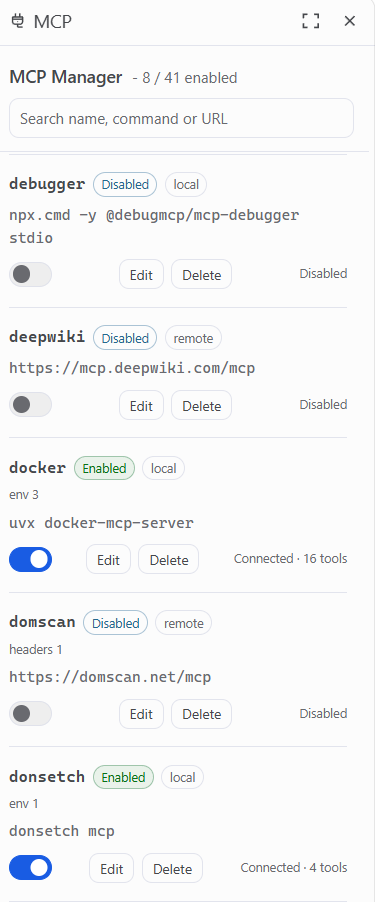
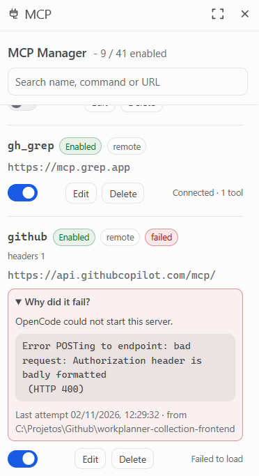
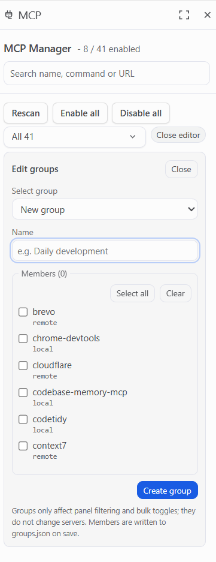

# openchamber-mcps · MCP Manager

**Every MCP server in your OpenCode config, on one screen.** Switch them on and off, see which
one is actually connected, and find out why one didn't load — without opening a JSON file.

An extension for OpenChamber that turns the `mcp.servers` block of your OpenCode config into a
panel you can read at a glance.



*Synthetic preview with sample servers. No real config is read or written.*

Version **0.1.0** · MIT · derived from [openchamber-skills](https://github.com/chenyuhao0628/openchamber-skills).

## The problem it removes

Your OpenCode config starts small. Then it grows: ten servers, twenty, forty — each one a block
of JSON you edit by hand. Which ones are on? Which are broken? Which are quietly doing nothing
because a tool was disabled or a URL is `http`? Nothing tells you, so you either remember or you
open the file and read.

MCP Manager puts the whole list in front of you, with a switch next to every row.

## What you get

- **One switch per server.** Off and on in a click; the panel writes the flag and OpenCode picks
  it up on its next config load.
- **The number you actually want:** `MCP Manager - 8 / 41 enabled`, live in the header.
- **Edit without fear.** Change a command, a URL, an `environment` entry or a header right in the
  panel. Everything is validated before a single byte is written, and the file is backed up first.
- **Know what is really happening.** Each row shows the transport, the command or URL, and the
  live state: **Starting…**, **Connected · 16 tools**, **Failed to load**, or
  **Enabled · not loaded yet**.
- **Failing servers explain themselves.** When OpenCode refuses a server, the row shows the cause
  it logged — status code and all — behind *Why did it fail?*.
- **Groups for the way you work.** Call one *Daily development*, one *Data*, one *Inbox*, then
  filter to it or flip the whole set at once.
- **Search that finds the right row.** By id, command, URL, environment key, header name, or by
  the warnings attached to it.
- **Problems surfaced, not hidden.** Duplicate definitions, invalid entries, servers whose tools
  are disabled by the `tools` section, remote URLs in plain `http` — all flagged, with the
  blocking ones listed first.

## Screenshots



*A server that refused to start, with the error OpenCode logged and where it happened.*



*Group editing: name a group, tick its members, filter and bulk-toggle by it.*

## Install

In OpenChamber open **Settings → Extensions → Add extension → URL**, paste this repository's URL,
and you are done. Requires OpenChamber **2.4.0 or newer**; the extension asks for no host
capabilities.

Working from a checkout instead:

```sh
npm ci && npm run typecheck && npm run test
```

then **Settings → Extensions → Add extension → Folder**, pick this directory and allow the local
service to run. `npm run test` builds first.

## What it actually changes

One field. Disabling a server writes `"disabled": true`, enabling writes `"disabled": false`,
inside `mcp.servers` of `~/.config/opencode/opencode.json` (or the `.jsonc` that defines it):

```json
{
  "mcp": {
    "servers": {
      "docker": { "type": "local", "command": ["uvx", "docker-mcp-server"], "disabled": false },
      "docs": { "type": "remote", "url": "https://example.test/mcp", "disabled": true }
    }
  }
}
```

Everything else in the file — `$schema`, theme, providers, the `tools` section — is left
byte-identical, comments and formatting included. The previous version of the file is kept as
`opencode.json.mcp-manager.bak`. Each write is re-parsed and compared before it replaces the
file; if the round-trip does not match, nothing is written.

Because OpenCode owns the servers, the panel never starts, stops or probes a process. Enabling a
server tells OpenCode it may start; the panel then watches the log for up to 15 seconds and says
**Enabled · not loaded yet** if the config has not been reloaded yet. Sessions that already
loaded their tools keep them until they reload — the panel says so in the footer.

## Built not to break your config

- Secrets stay in the config: `environment` and `headers` values are blanked on read and
  re-attached from the stored definition when you leave the field empty.
- The local service listens on `127.0.0.1` only, with a Bearer token check, and declares no
  outbound network, socket or exec permission beyond its host-assigned loopback port.
- The only outbound call is importing a server by URL, on your explicit request.
- Deleting a server removes the key, not the file — and the file is backed up first.
- Without a valid, readable config, the panel refuses to write anything and says why.

## What it does not do

- **No process supervision.** OpenCode starts, stops and health-checks MCP servers; this panel
  never does. Failure reasons are read from OpenCode's own log (last 4 MB).
- **No background watcher.** Press **Rescan** after the config changes elsewhere.
- **No create or import screen in the panel.** Servers are added to `mcp.servers` by hand (the
  service still exposes `POST /servers/import` for scripts); the panel edits and toggles what is
  already there.
- **Global config only.** `~/.config/opencode/opencode.json` and `.jsonc`. Project config,
  `.opencode/`, `OPENCODE_CONFIG` and managed config are not managed.
- **No token estimates or tool lists** — both need a live MCP connection, which the panel
  deliberately does not open.
- `timeout`, `codemode`, `protocol` and `oauth` are preserved but not editable; `timeout` inside
  `mcp.servers` is an object, not a number.
- Inside the `mcp` block written servers are re-serialised, so comments there are lost and a
  hand-written single-line object is reflowed. Everything outside `mcp` keeps its bytes.
- A secret cannot be cleared by emptying the field — delete the row instead.
- Two windows editing at once is last-write-wins; each write is still atomic (temp file + rename).
- Disabling the extension stops the service. It does not re-enable or remove any server.

## Development

```sh
npm run build      # esbuild → panel/main.js (iife) and service/main.js (esm)
npm run typecheck  # tsc --noEmit, strict
npm run test       # builds, then node --experimental-strip-types --test tests/*.test.*
npm run preview    # synthetic data on 127.0.0.1, never reads your config
```

The architecture is the one inherited from openchamber-skills: a panel iframe, a local service on
loopback, and a shared data contract between them.

## Credits

Built on [**openchamber-skills**](https://github.com/chenyuhao0628/openchamber-skills) by
[@chenyuhao0628](https://github.com/chenyuhao0628): the extension architecture (panel iframe +
local service + shared contract), the panel layout and interaction model, the conflict and group
concepts, and most of the documentation structure came from there. What changed is the domain —
MCP servers instead of skill files — and the write path that came with it.

If you want to manage OpenCode skills rather than MCP servers, use the original project.

## Docs

- [DECISIONS.md](DECISIONS.md) — every deliberate divergence, with reasons.
- [MCP_MAPPING.md](MCP_MAPPING.md) — concept-by-concept mapping from the original.
- [ANALYSIS_SKILLS.md](ANALYSIS_SKILLS.md) — how the reference extension is built.
- [docs/EXAMPLES.md](docs/EXAMPLES.md) — worked examples.
- [docs/MANUAL_TESTS.md](docs/MANUAL_TESTS.md) — manual test checklist.

## License

MIT.
